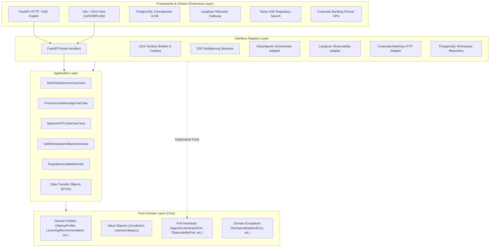
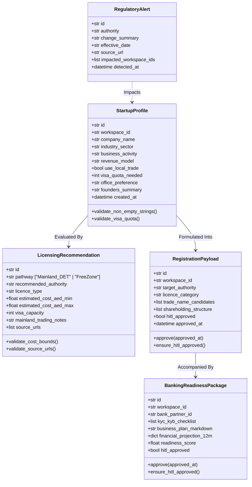
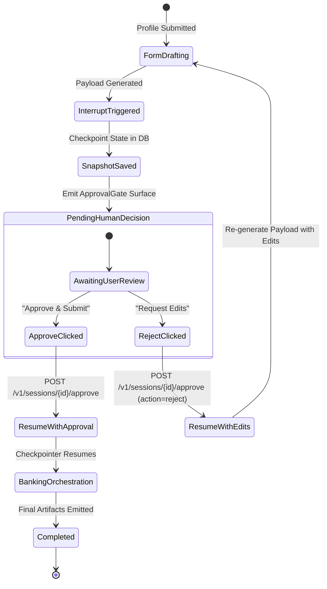
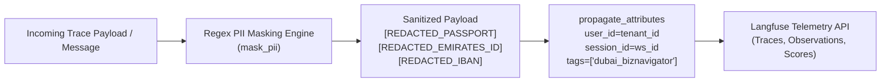
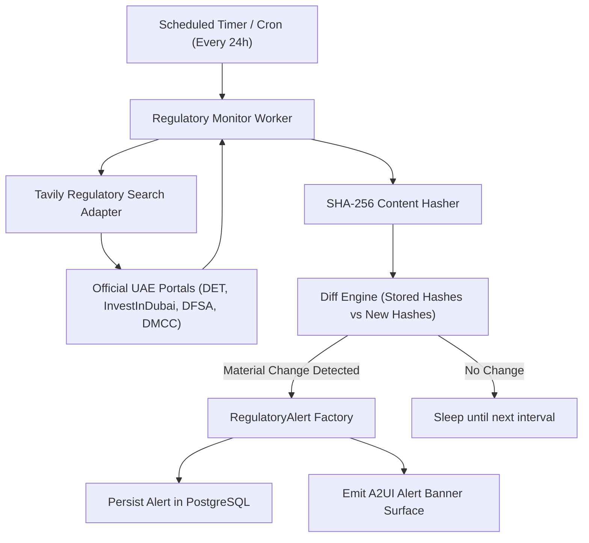

# Dubai BizNavigator — Architectural Specification

> **Autonomous Multi-Agent UAE Corporate Formation, Trade Licensing & Banking Orchestration**
>
> **Version:** 1.0.0  
> **Architecture Pattern:** Clean Architecture (Robert C. Martin / Uncle Bob) with Ports & Adapters (Hexagonal Architecture)  
> **Runtime Engines:** LangGraph / DeepAgents (Python), FastAPI (ASGI), Vite + @a2ui (JavaScript)  
> **Telemetry & Observability:** Langfuse SDK v3+ with Zero-OTLP TracerProvider Isolation  

---

## Table of Contents

1. [Architectural Philosophy & Core Principles](#1-architectural-philosophy--core-principles)
2. [Concentric Layer Architecture & Boundaries](#2-concentric-layer-architecture--boundaries)
3. [Domain Model & Invariants](#3-domain-model--invariants)
4. [Multi-Agent Swarm Orchestration (DeepAgents + LangGraph)](#4-multi-agent-swarm-orchestration-deepagents--langgraph)
5. [A2UI Declarative Interface Protocol](#5-a2ui-declarative-interface-protocol)
6. [Human-in-the-Loop (HITL) Checkpointing Lifecycle](#6-human-in-the-loop-hitl-checkpointing-lifecycle)
7. [Observability, Telemetry & PII Masking Pipeline](#7-observability-telemetry--pii-masking-pipeline)
8. [Persistence & Workspace Storage Architecture](#8-persistence--workspace-storage-architecture)
9. [Regulatory Change Monitor Worker Architecture](#9-regulatory-change-monitor-worker-architecture)
10. [Corporate Banking Partner Integration Architecture](#10-corporate-banking-partner-integration-architecture)

---

## 1. Architectural Philosophy & Core Principles

Dubai BizNavigator enforces strict **Clean Architecture** rules to guarantee long-term maintainability, testability, and technology independence:



### The Dependency Rule
- **Dependencies point strictly inward**. Nothing in the `domain/` layer has any knowledge of databases, web frameworks, agent libraries, or serialization protocols.
- **Pure Domain Isolation**: Zero third-party runtime imports in `backend/app/domain/` except standard Python typing, dataclasses, and Pydantic v2 validation models. Absolutely no imports of `fastapi`, `langchain`, `langgraph`, `deepagents`, `langfuse`, or `a2ui`.
- **Ports & Adapters**: Application use cases communicate with external worlds solely through abstract Port interfaces (`backend/app/domain/ports.py`). Concrete implementations reside in `backend/app/infrastructure/`.

---

## 2. Concentric Layer Architecture & Boundaries

```
backend/app/
├── domain/                      # LEVEL 1: Enterprise Business Rules
│   ├── entities.py              # Pure entities (StartupProfile, LicensingRecommendation, etc.)
│   ├── ports.py                 # Abstract port protocols (Agent, Repository, Observability, Banking)
│   ├── exceptions.py            # Domain exceptions (DomainValidationError, HITLApprovalRequiredError)
│   └── value_objects/           # Immutable domain types (Jurisdiction, LicenseCategory)
│
├── application/                 # LEVEL 2: Application Business Rules & Use Cases
│   ├── use_cases.py             # Workflow coordinators (StartSession, ProcessMessage, ApproveHITL)
│   ├── regulatory_monitor.py    # Autonomous regulatory change detection service
│   └── dtos/                    # Input/Output Data Transfer Objects
│
├── infrastructure/              # LEVEL 3: Interface Adapters & Concrete Frameworks
│   ├── agents/                  # DeepAgents & LangGraph runtime adapters
│   │   ├── orchestrator.py      # Lead coordinator agent with LangGraph checkpointing
│   │   ├── subagents/           # 5 specialized subagent specifications (Licensing, Banking, etc.)
│   │   └── tools/               # Grounded regulatory search tools (Tavily UAE adapter)
│   ├── observability/           # Langfuse SDK v3+ observability adapter
│   ├── banking/                 # Corporate banking partner HTTP adapter with HMAC verification
│   ├── repositories/            # PostgreSQL workspace and profile persistence
│   └── workers/                 # Scheduled monitor background worker
│
└── interfaces/                  # LEVEL 4: External Frameworks & Drivers
    ├── api/                     # FastAPI REST routes and webhook handlers
    ├── a2ui/                    # A2UI declarative surface builder, catalog & SSE streamer
    └── container.py             # Dependency Injection container assembling the system
```

---

## 3. Domain Model & Invariants

### Core Entities & Lifecycles



### Key Business Invariants
1. **Cost Bounds Invariant**: `estimated_cost_aed_max >= estimated_cost_aed_min >= 0.0`. A negative cost or inverted range raises `DomainValidationError`.
2. **Citation Requirement**: A `LicensingRecommendation` must contain at least one verified official source URL. Uncited guidance is rejected at the domain boundary.
3. **HITL Gate Invariant**: Calling external corporate registration APIs or banking partner submissions without `hitl_approved == True` raises `HITLApprovalRequiredError`. No side-effecting external transaction can occur without human confirmation.
4. **Zero-PII Storage**: All storage and telemetry payloads must be scrubbed of raw passport numbers, Emirates IDs (`784-XXXX-XXXXXXX-X`), and UAE IBANs (`AE...`).

---

## 4. Multi-Agent Swarm Orchestration (DeepAgents + LangGraph)

The orchestration tier utilizes LangChain's `deepagents` architecture running on the `LangGraph` stategraph runtime.

```mermaid
sequenceDiagram
    autonumber
    actor User as Founder / Client
    participant UI as Vite + A2UI Host
    participant API as FastAPI Gateway
    participant Orch as DeepAgents Orchestrator
    participant Sub1 as Licensing Strategist
    participant Sub2 as Regulatory Researcher
    participant Sub3 as Form Automation Agent
    participant Sub4 as Banking Advisor
    participant Sub5 as Compliance Auditor
    participant Checkpoint as PostgreSQL Checkpointer

    User->>UI: Submit Profile Intake Form
    UI->>API: POST /v1/sessions/{id}/messages (SSE)
    API->>Orch: stream_subagents(profile, session_id)
    
    rect rgb(30, 41, 59)
        Note over Orch,Sub5: Stage 1: Strategy & Regulatory Verification
        Orch->>Sub1: Read /workspace/startup_profile.json
        Sub1->>Sub2: Query official DET / Free Zone guidelines
        Sub2-->>Sub1: Verified tax & foreign ownership rules
        Sub1->>Orch: Write /workspace/licensing_matrix.md
        Orch-->>API: SSE event: a2ui_surface (Licensing Matrix)
    end

    rect rgb(45, 30, 45)
        Note over Orch,Checkpoint: Stage 2: Registration & HITL Decision Gate
        Orch->>Sub3: Draft Registration Payload & MOA Structure
        Sub3->>Orch: Write /workspace/registration_payload.json
        Sub3->>Orch: Trigger LangGraph Interrupt (__interrupt__)
        Orch->>Checkpoint: Persist State Snapshot (Thread ID: ws_id)
        Orch-->>API: SSE event: a2ui_surface (ApprovalGateCard)
        API-->>UI: Render Interactive Approval Gate
    end

    User->>UI: Click "Approve & Submit"
    UI->>API: POST /v1/sessions/{id}/approve
    API->>Orch: resume_execution(action="hitl_approve")
    Orch->>Checkpoint: Resume from Snapshot (Thread ID: ws_id)

    rect rgb(20, 45, 35)
        Note over Orch,Sub5: Stage 3: Banking Dossier & Compliance Audit
        Orch->>Sub4: Draft KYB Dossier & Financial Model
        Sub4->>Orch: Write /workspace/business_plan.md
        Orch->>Sub5: Read-Only Compliance Critique
        Sub5->>Orch: Write /workspace/compliance_checklist.md
        Sub5-->>Orch: Zero-PII & Sanctions Audit PASSED
        Orch-->>API: SSE event: a2ui_surface (Business Plan & Checklist)
        API-->>UI: Render Final Documentation Surfaces
    end
```



### The 5 Specialized Subagents

| Subagent Name | Role | Allowed Tools | Virtual Workspace File Contract |
|---|---|---|---|
| `licensing-strategist` | Scorer comparing DET Mainland vs Free Zones (DMCC, DIFC, IFZA, DIC) | `read_file`, `write_file`, `query_uae_regulations` | Reads `/workspace/startup_profile.json`<br/>Writes `/workspace/licensing_matrix.md` |
| `regulatory-researcher` | Authoritative search for Tax (CIT/VAT), ESR, and UBO mandates | `search_uae_regulations`, `fetch_gazette_ruling` | Read-only advisory; emits inline citations to official portals |
| `form-automation-agent` | Commercial registration payload & MOA preparation | `read_file`, `write_file`, `trigger_hitl_gate` | Writes `/workspace/registration_payload.json`<br/>Triggers `__interrupt__` |
| `banking-readiness-agent`| Corporate KYB dossier, financial projections & partner matching | `read_file`, `write_file`, `fetch_bank_requirements` | Writes `/workspace/business_plan.md`<br/>Generates 12m financial model |
| `compliance-auditor` | Read-only critique subagent verifying regulatory compliance | `read_file` (Write access strictly DENIED via sandbox) | Writes `/workspace/compliance_checklist.md` |

---

## 5. A2UI Declarative Interface Protocol

The frontend never renders raw HTML or arbitrary scripts emitted by LLMs. Instead, the backend constructs validated JSON structures conforming to the **A2UI Transport Protocol**:

```mermaid
flowchart LR
    subgraph Backend ["FastAPI / A2UI Builder"]
        DomainOutput["Domain Entities & Recommendations"]
        CatalogValidator["Catalog Schema Validator<br/>(biznavigator_a2ui_v1)"]
        SurfaceBuilder["A2UISurfaceBuilder"]
        SSEFormatter["SSE Chunk Formatter"]
    end

    subgraph Wire ["Network Transport"]
        SSEStream["text/event-stream (HTTP)"]
    end

    subgraph Frontend ["Client Browser"]
        EventReader["AgentClient (ReadableStream Reader)"]
        MsgProc["@a2ui/web_core MessageProcessor"]
        HostRenderer["A2UIHost (Native DOM Components)"]
        Sanitizer["DOMPurify + @a2ui/markdown-it"]
    end

    DomainOutput --> SurfaceBuilder
    SurfaceBuilder --> CatalogValidator
    CatalogValidator --> SSEFormatter
    SSEFormatter --> SSEStream
    SSEStream --> EventReader
    EventReader --> MsgProc
    MsgProc --> HostRenderer
    HostRenderer --> Sanitizer
```



### Allowed Widget Catalog (`biznavigator_a2ui_v1`)
1. `Text`: Header (`title`, `subtitle`), body, or caption with style variants.
2. `Column`: Vertical flexbox container with configurable alignment and spacing.
3. `Row`: Horizontal flexbox container with responsive wrap and justification.
4. `Card`: Elevated container with border highlight, title, and child container.
5. `DataTable`: Structured tabular display for multi-jurisdiction comparison.
6. `Badge`: Status tags (`Mainland_DET`, `FreeZone`, `Approved`, `Pending`, `Risk`).
7. `TextField`: Secure text/number input with validation constraints.
8. `Select`: Dropdown selection for jurisdiction choices, office types, and categories.
9. `Button`: Action dispatchers (`primary`, `secondary`, `danger`, `success`) triggering wire events.
10. `ApprovalGateCard`: High-security container rendering payload previews with approval controls.
11. `MarkdownViewer`: Rendered via `@a2ui/markdown-it` and sanitized via `DOMPurify` for verified citations and business plans.

---

## 6. Human-in-the-Loop (HITL) Checkpointing Lifecycle

To prevent accidental, unreviewed, or legally binding submissions:



1. **State Snapshot**: When `form-automation-agent` prepares `/workspace/registration_payload.json`, it calls `interrupt()`.
2. **Durable Persistence**: LangGraph's checkpointer (`PostgresSaver` in production, `MemorySaver` in testing) serializes the exact execution graph state under `thread_id = workspace_id`.
3. **Approval Surface**: The backend emits an `ApprovalGateCard` A2UI surface with the complete payload preview.
4. **Client Decision**: The user inspects the payload summary table and clicks *"Approve & Submit"*.
5. **Resume Execution**: FastAPI receives `POST /v1/sessions/{session_id}/approve`, calls `orchestrator.resume_execution(action="hitl_approve")`, and streams subsequent stages (Banking and Compliance).

---

## 7. Observability, Telemetry & PII Masking Pipeline

### Zero OTLP Conflict Guarantee
To prevent `TracerProvider` collisions and memory leaks caused by competing telemetry systems:
- LangSmith environment flags are explicitly turned off:
  ```ini
  LANGSMITH_TRACING=false
  LANGSMITH_OTEL_ENABLED=false
  ```
- No competing OpenTelemetry exporters (`opentelemetry-exporter-otlp-proto-http`) targeting LangSmith are imported.
- All telemetry routes through Langfuse SDK v3+ (`langfuse.get_client()`).

### Multi-Tenant Attribute Propagation & PII Redaction


---

## 8. Persistence & Workspace Storage Architecture

The persistence model separates operational graph state from domain assets:

1. **PostgreSQL Checkpointer (`checkpoints` table)**:
   - Manages durable LangGraph threads (`thread_id`, `checkpoint_id`, `state_blob`).
   - Supports atomic resumes after system restarts or worker redeployments.
2. **Workspace Repository (`workspaces` & `profiles` tables)**:
   - Stores domain entities: `StartupProfile`, `LicensingRecommendation`, `RegistrationPayload`, `BankingReadinessPackage`.
3. **Virtual Filesystem (`/workspace/`)**:
   - Resides in memory/state-backend during agent turns.
   - Structured JSON and Markdown documents persist as inspectable workspace artifacts.

---

## 9. Regulatory Change Monitor Worker Architecture

An autonomous background worker runs on a scheduled interval to protect established entities against regulatory drift:



---

## 10. Corporate Banking Partner Integration Architecture

The corporate banking adapter provides automated account opening readiness:
- **Idempotency**: All partner API calls include an `Idempotency-Key` header with exponential backoff retries.
- **HMAC-SHA256 Webhooks**: Asynchronous KYC/KYB status updates delivered to `POST /v1/webhooks/banking` are cryptographically verified using `X-Signature-SHA256` before processing.
- **Circuit Breaker**: Outbound partner HTTP calls use timeouts and retry limits to prevent cascading gateway failures.
